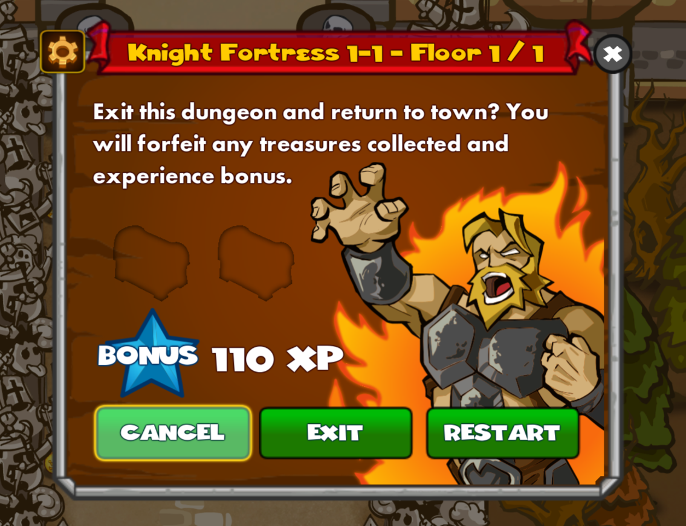
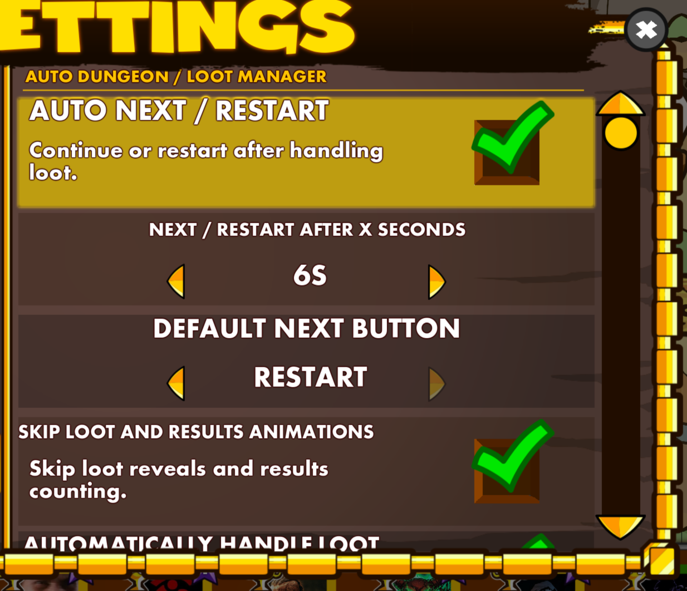
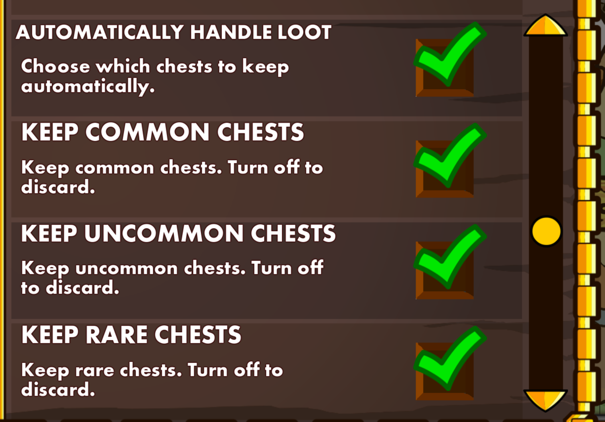

# Auto Dungeon / Loot Manager

<!-- drh:show -->
Manage dungeon rewards and optionally continue or restart after the results.

- Adds a native Restart button to the exit menu and a second button to the results screen.
- Default Next button chooses Next or Restart as the main results button and the automatic action.
- Auto Next / Restart waits 0–10 seconds after rewards are handled; the default delay is 6 seconds. Manual Next, Restart or Exit cancels it for that run.
- Automatically handle loot keeps or discards chest types using your saved rules. With it off, choose loot manually; the timer waits until all reward dialogs close.
- Skip loot and results animations speeds up results counting and loot reveals. The dungeon victory animation plays normally.
- Ctrl + Shift + R restarts the current dungeon. The shortcut is registered through the Mod API and appears in Settings → Controls.
- Settings → Mods contains the options; changes save automatically. The previous Friends Only setting is kept on re-entry.
<!-- /drh:show -->

## Preview

### Restart from the exit menu

<table>
<tr>
  <td align="center"> Standard dungeon restart</td>
  <td align="center"> Ultimate Rampage restart</td>
</tr>
</table>

### Settings

<table>
<tr>
  <td align="center"> Automation, countdown and animations</td>
  <td align="center"> Chest rules</td>
  <td align="center"> Legendary chests and item boxes</td>
</tr>
</table>

### Results screen

<table>
<tr>
  <td align="center"> Restart as the default</td>
  <td align="center"> Next as the default</td>
</tr>
</table>

## Rewards

All chest types are kept by default. Common, uncommon, rare, legendary, small item boxes and royal item boxes have separate rules. Unknown rewards are kept. A keep request waits for server confirmation and the account refresh; storage-full, transaction errors and timeouts pause automation without discarding the chest.

Early restart has the same completion-XP and treasure loss as leaving normally. Re-entry uses normal matchmaking for the same dungeon type; the server chooses its instance and layout.

## Compatibility

DRH 18 and Mod API 1.4.0 or compatible later 1.x. This mod uses game internals (`extends`) and can need updates after a game change. Use it in place of Quick Dungeon Restart, Instant Victory Reveal and Summary Chest Rules to avoid competing summary handlers.

## Validation

Launcher validation and 41 isolated Haxe countdown and reward checks pass. Run `tests/run.ps1 -Haxe <path-to-haxe.exe>` to reproduce them.
