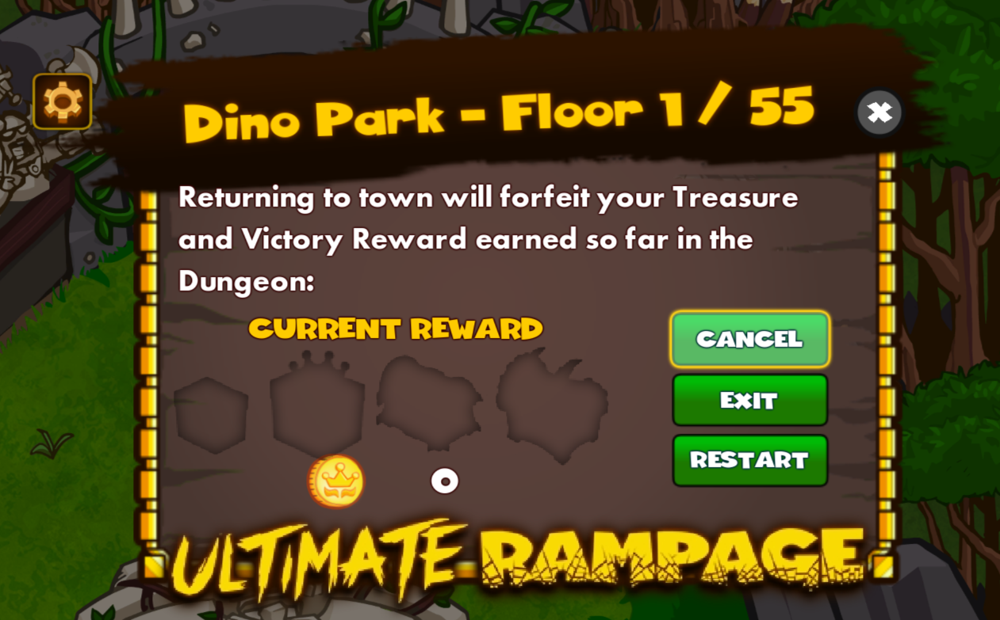
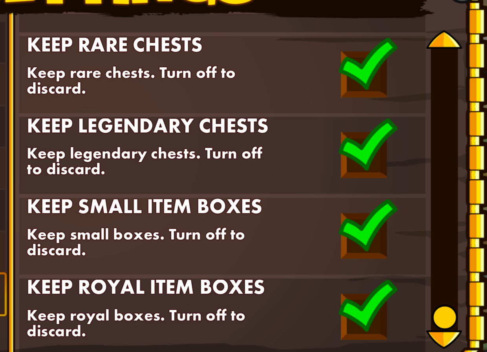
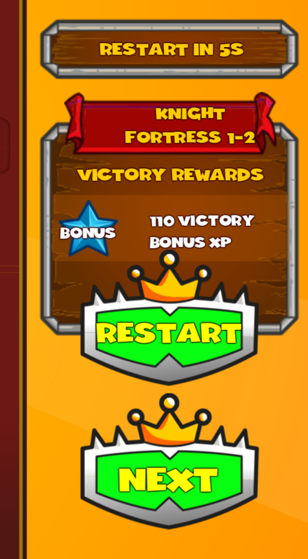
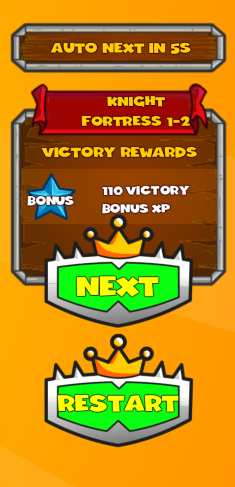

# Auto Dungeon / Loot Manager

<!-- drh:show -->
Manage dungeon rewards and optionally continue or restart after the results.

- Adds a native Restart button to the exit menu and a second button to the results screen.
- Default Next button chooses Next or Restart as the main results button and the automatic action.
- Auto Next / Restart waits 0-10 seconds after rewards are handled; the default delay is 6 seconds. Manual Next, Restart or Exit cancels it for that run.
- If reward handling pauses after an error, automatic progression resumes once the native summary confirms no remaining rewards or open dialogs for half a second.
- Automatically handle loot keeps or discards chest types using your saved rules. With it off, choose loot manually; the timer waits until all reward dialogs close.
- Skip loot and results animations speeds up results counting and loot reveals, and dismisses the level-up Sweet popup. Turn this setting off to keep Sweet popups for manual dismissal. The dungeon victory animation plays normally.
- Ctrl + Shift + R restarts the current dungeon. The shortcut is registered through the Mod API and appears in Settings > Controls.
- Settings > Mods contains the options; changes save automatically. The previous Friends Only setting is kept on re-entry.

Based on Danny's [Quick Dungeon Restart](https://github.com/rendable/DRH-Mod-Quick-Dungeon-Restart) and [Instant Victory Reveal](https://github.com/rendable/DRH-Mod-Instant-Victory-Reveal), and iClawSuit's [Summary Chest Rules](https://github.com/clawsuit/DRH-Mod-SummaryChestRules). Disable those three mods when using Auto Dungeon / Loot Manager to avoid competing summary handlers.
<!-- /drh:show -->

## Preview

### Restart from the exit menu

<table>
<tr>
  <td align="center"> Standard dungeon restart</td>
  <td align="center"> Ultimate Rampage restart</td>
</tr>
</table>

### Settings

<table>
<tr>
  <td align="center"></td>
  <td align="center"></td>
  <td align="center"></td>
</tr>
</table>

### Results screen

<table>
<tr>
  <td align="center"> Restart as the default "Next" button in settings</td>
  <td align="center"> Next as the default "Next" button in settings</td>
</tr>
</table>

## Rewards

All chest types are kept by default. Common, uncommon, rare, legendary, small item boxes and royal item boxes have separate rules. Unknown rewards are kept. A keep request waits for server confirmation and the account refresh; a slow confirmation keeps waiting without repeating the request, while full storage and transaction errors pause automation without discarding the chest. With Full Inventory loaded, auto loot can try to keep a chest even when the standard storage check would block it. The server must still accept the request.

Early restart has the same completion-XP and treasure loss as leaving normally. Re-entry uses normal matchmaking for the same dungeon type; the server chooses its instance and layout.

## Compatibility

Works alongside Party Auto Join 0.1.67 or later using shared in-process state, without heartbeat files (0.1.73 or later is recommended). While following a leader, Party Auto Join holds automatic Next/Restart; loot handling and animation skipping continue. Manual mode restores normal progression.

DRH 18 and Mod API 1.5.0 or compatible later 1.x. This mod uses game internals (`extends`) and can need updates after a game change.

## License

[MIT](LICENSE).

## Validation

Launcher validation and isolated Haxe countdown, reward and level-up dismissal checks pass. Run `tests/run.ps1 -Haxe <path-to-haxe.exe>` to reproduce them.

The Restart control and dungeon/floor title also support the separate death/revive exit confirmation. That popup is discovered through its small native navigation graph, since ActorReviveState does not retain it on the HUD. Native Cancel closes the confirmation before the usual server-confirmed restart exit flow.

## Release text integrity

Release packaging uses `python scripts/release.py`. It reads and writes explicit UTF-8/bytes, checks all tracked text and release scripts for unexpected non-ASCII/control characters, validates decoded JSON strings, and verifies every ZIP entry against source bytes. Launcher descriptions use plain ASCII punctuation such as `0-10` and `Settings > Mods`. This deliberately strict policy prevents accidental encoding conversions from entering future releases. After publication, both assets are downloaded and compared with their local files. Runtime behavior is unchanged in 0.2.29.

## Changes since 0.2.30

- Party Auto Join integration reads a hidden, non-interactive marker from the shared overlay, including sibling per-mod overlay layers. Party Auto Join 0.1.67-0.1.72 still works through the older shared fields. Following holds automatic Next/Restart while loot handling continues.
- Ultimate Rampage final victory: at floor 55 of an `INFINITE_` dungeon, automatic progression returns to town after reward processing instead of retrying or selecting Next. Manual restart remains available; Party following holds still take priority.
- Slow keep confirmations and slow chest artwork no longer hit a fixed timeout. Keep requests stay sequential and are not repeated while waiting, so all four summary chests can be kept on a slow game. Storage-full and transaction errors still pause automation.
- Fixed duplicate chest prompts on the results screen and KEEP reporting "Transaction failed" when chest artwork loaded late: animation skipping now only advances reveal tasks still queued in the work loop (contributed by Tutez64).
